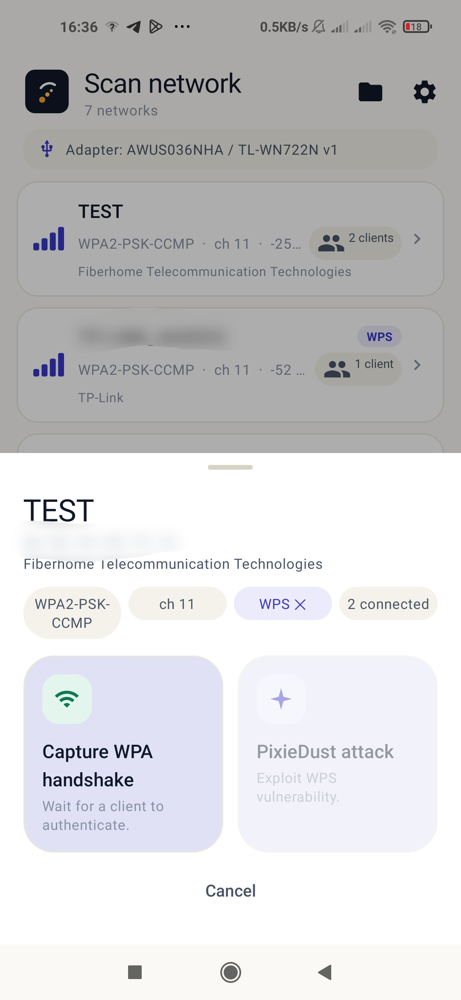
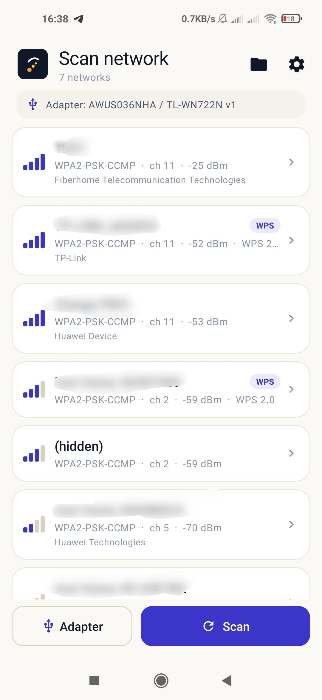

# Pixie Dust — Project README

> **Read the article:** [Pixie Dust: Auditing WPS and WPA Security from an Android Phone, Without Root](ARTICLE.md) — a full technical write-up covering the architecture, the libusb-on-Android work, the interface, the safety rules and the honest limits of the project.

## Purpose and ethics

**Pixie Dust is a cybersecurity tool.** Its purpose is to help a network owner (or a tester who has written authorization) evaluate the security of a **WPS** deployment and of the **WPA 4-way handshake** on a Wi-Fi network, and to discover weaknesses before an attacker does.

- Use it **only on networks you own** or for which you have **explicit written permission** to test.
- The app asks for confirmation before every operation and shows a consent dialog before the first frame is transmitted.
- It has no `INTERNET` permission and cannot transmit anything: recovered PINs/passwords stay on the device.
- Misuse of this tool against networks you do not own is illegal in most jurisdictions.

## Short description

**Pixie Dust** is a security app for Android that audits the security of **WPS** (Wi-Fi Protected Setup) on wireless networks over a **USB OTG** port.

The app is written in **Java + XML** with an internal **Python** engine, and runs on the embedded **libusb** engine. Its goal: audit a **PIN**, then extract the **PSK**, without root, without `wpa_supplicant`, without internet, and with a single attempt only.

## Features

- **Pixie Dust WPS audit** with one user-confirmed PIN attempt per run; the supported model and router behavior determine whether a PIN or PSK is returned.
- **WPA 4-way handshake capture** is validated by the bundled handshake validator before a pcap is saved; invalid or incomplete captures are reported and never presented as valid files.
- **Live client table** during scans and capture, showing observed client MAC addresses and signal strength. It follows a device when it appears and removes it when it disconnects.
- **Network list sorted by signal strength** (strongest first) and showing the manufacturer and, when known, router model. Manufacturer/model values are cached on-device, so a later scan that misses the WPS information element still shows the same router.
- **Handshake storage in `Download/Hanshake`** (not `Android/data`), with a Settings option to pick another system folder or a custom folder name.
- **Results and private history** show verified captures and credentials recovered on-device. History is stored locally and is not sent over the network.
- **English and French** interface; light theme only.
- No third-party product name is displayed in the interface; the required license and NOTICE files still ship with the source and the app.

## Technical architecture

- UI: Java + XML, two locales: English, French.
- Engine: Python 3.11 (Chaquopy) + libusb 1.0.30.
- ABIs: arm64-v8a + armeabi-v7a (no x86, no emulator).
- Signing: release, v2, certificate SHA-256 `18fab90662b96344e4548c36bcc5eebbb7c714582af2b120b746cdbfcfabb17c`.

## Build and verification status

This source tree builds release `1.0.5` (versionCode `6`). Verify the produced APK with `apksigner` before installing it, and check the package/version with `aapt2 dump badging`.

Physical testing with an Android phone and a supported USB OTG Wi-Fi adapter is still required. No real-device test is claimed here.

## Safety and privacy

- WPS validation makes one attempt only; no automatic retries, online PIN guessing, OneShot, PBC/WEP, root, or `wpa_supplicant`.
- Optional deauthentication during a capture is bounded and targeted; it is not a flood. Use only on networks you own or are authorized to test.
- Recovered PINs/passwords are stored in the app-private on-device history. Clear history in the app to remove those records. The app has no `INTERNET` permission and does not transmit this history.
- No real-device functionality is claimed until tested with compatible hardware.

---

## End of README

---

## Full article (technical write-up)


# Pixie Dust: Auditing WPS and WPA Security from an Android Phone, Without Root

*A technical walkthrough of a native Android app that runs a complete USB Wi-Fi security audit on a phone, with no root, no `wpa_supplicant`, and no internet permission.*

---

## Why this project exists

Most Wi-Fi security tooling lives on a laptop. You install a Linux distribution, patch a driver to support monitor mode and packet injection, plug in a compatible USB adapter, and start `aircrack-ng`, `reaver`, or `hashcat`. It works, but it is heavy. It needs a second machine, a specific operating system, and a stack of driver patches that break with every kernel update.

Phones are the opposite: always with you, always charged, and — thanks to USB On-The-Go — perfectly capable of hosting a USB Wi-Fi adapter. What has been missing is the software layer that makes that hardware usable on unrooted Android.

**Pixie Dust** is an attempt to fill that gap. It is a single Android application, written in Java with an embedded Python engine, that brings a WPS audit and a WPA handshake capture to an ordinary phone. It does not require root, it does not touch `wpa_supplicant`, and it cannot send anything over the network, because it does not even request the `INTERNET` permission.

The project is open source under GPL-2.0:

**https://github.com/mohadexter/Pixie-Dust-for-android-without-root**

---

## Android version support

| Property | Value |
|---|---|
| `minSdk` | **24 — Android 7.0 (Nougat)** |
| `targetSdk` / `compileSdk` | **36 — Android 16** |
| ABIs | `arm64-v8a`, `armeabi-v7a` (ARM only, no x86, no emulator) |
| Languages | English, French |
| Theme | Light only |
| Internet permission | None (the app cannot transmit anything) |

The app runs on any Android phone from Android 7.0 up to Android 16, as long as the phone supports USB OTG and can power the adapter (high-power adapters may need a powered hub).

---

## Screenshots (real device)

The following screenshots were taken on a real Android phone running Pixie Dust 1.0.5.



*The scan screen: app icon in the header, "Scan network" title, adapter status, network count and the empty state.*


*The network detail sheet with the two action cards side by side: "Capture WPA handshake" (green) and "PixieDust attack" (violet).*


*The capture screen: the five-stage stepper, the live operation log, and the single Start/Stop button.*



*The small success frame over the screen, with the file path in heavier monospace text.*

---

## What the app actually does

Pixie Dust has two jobs, and it keeps them strictly separate.

### 1. WPS PIN audit (the "Pixie Dust attack")

WPS — Wi-Fi Protected Setup — was designed to let a user join a network by typing an eight-digit PIN instead of a long passphrase. That convenience came at a cost. On a class of routers built around weak random number generators, the WPS exchange leaks enough information to recover the PIN offline.

The app performs **exactly one** attempt per run:

1. The adapter opens the target channel and brings up monitor receive.
2. The engine captures the WPS **M1, M2 and M3** messages.
3. The offline search reconstructs the router's nonces and derives a candidate PIN.
4. The candidate is validated in a single **M4–M7** exchange.
5. If the router accepts it, the same session asks for the passphrase, and the PSK comes back.

There is no retry loop. If the router rejects the attempt, or if it is not vulnerable at all, the app says so and stops.

### 2. WPA 4-way handshake capture

The second job is the classic one. The app tunes to the target network, listens to the channel, and waits for a client to authenticate so it can record the four-way handshake. If no client reconnects on its own, a **bounded and targeted** deauthentication burst nudges the clients already observed on that BSSID into reconnecting.

A capture is only reported as a success if the bundled validator finds a **crackable pair** — an actual M1/M2 pair from the same session.

---

## The architecture

The application is deliberately conservative about its dependencies. It uses plain Android Views, not Compose. The UI layer is Java and XML. The engine layer is Python, running in-process.

```
┌────────────────────────────────────────────────────────┐
│  Java UI  (Activities, ViewBinding, Material 3)        │
│  Scan · Details · Handshake · Attack · Result · …      │
└───────────────────────┬────────────────────────────────┘
                        │  Repo: one observable state
                        │  object, one listener, main thread
┌───────────────────────▼────────────────────────────────┐
│  Bridge.java  →  pixie_android.bridge (Python)         │
│  JSON contract, one engine thread ("pixie-engine")     │
└───────────────────────┬────────────────────────────────┘
                        │
┌───────────────────────▼────────────────────────────────┐
│  Python 3.11 (Chaquopy)                                │
│    pixie/        capture logic, PIN search, validation │
│    wifit3/       chipset drivers, firmware, monitor    │
│    pixie_android/  bridge, libusb_fd, callbacks        │
└───────────────────────┬────────────────────────────────┘
                        │  libusb 1.0.30
┌───────────────────────▼────────────────────────────────┐
│  USB OTG  →  RTL8812AU / MT7921AU / AR9271 / …         │
└────────────────────────────────────────────────────────┘
```

### One thread owns the radio

The single most important design decision is that **exactly one thread ever talks to the USB device**. The engine runs on a dedicated `pixie-engine` thread, and every operation — scan, capture, WPS attempt — is serialised through it.

The UI never blocks on the engine. It reads a single observable state object (`Repo`) and redraws.

### Getting libusb to work on Android without root

On a desktop, libusb opens a device by path. On Android, the USB device node under `/dev/bus/usb/` is not readable by an ordinary app. An app *can* get a **file descriptor** from the system, after the user grants permission through the standard OTG dialog.

The bridge therefore hands libusb an already-open descriptor instead of a device path, and lets libusb wrap it. The bundled `libusb_fd.py` module handles that handover and the platform quirks, including `libusb_get_configuration` failing with `Operation not permitted` on some chipset/phone combinations.

Native libraries must exist as **real files on disk**, not inside the APK's zip. The build is configured with `useLegacyPackaging = true` so libusb is extracted at install time.

### Supported hardware

The driver stack covers a wide range of USB adapters. The **Bands** column is the single most useful piece of information for a buyer: it tells you whether the adapter can reach 5 GHz and 6 GHz networks or is limited to 2.4 GHz.

| Group | Chipset | Adapter / variant | Bands |
|---|---|---|---|
| Ralink | RT5370 | — | **2.4 GHz only** |
| Ralink | RT5372 | — | 2.4 / 5 GHz |
| Ralink | RT5572 | MIMO | 2.4 / 5 GHz |
| Ralink | RT3070 | high power | **2.4 GHz only** |
| Ralink | RT2570 | legacy | **2.4 GHz only** |
| MediaTek | MT7601U | (Ralink id) | **2.4 GHz only** |
| MediaTek | MT7610U | AC600 | 2.4 / 5 GHz |
| MediaTek | MT7612U | AC1200 | 2.4 / 5 GHz |
| MediaTek | MT7921AU | Wi-Fi 6 | 2.4 / 5 GHz |
| MediaTek | MT7925U | Wi-Fi 7 | **2.4 / 5 / 6 GHz** |
| Atheros | AR9271 | AWUS036NHA | **2.4 GHz only** |
| Realtek | RTL8187 / RTL8188EUS / RTL8192FU | — | **2.4 GHz only** |
| Realtek | RTL8812AU | AWUS036ACH | 2.4 / 5 GHz |
| Realtek | RTL8814AU | AC1900 | 2.4 / 5 GHz |
| Realtek | RTL8821AU | AC600 | 2.4 / 5 GHz |
| Realtek | RTL8822BU | AC1200 | 2.4 / 5 GHz |
| Realtek | RTL8922AU | Wi-Fi 7 | **2.4 / 5 / 6 GHz** |
| Realtek | RTL8811CU / RTL8822CU | — | 2.4 / 5 GHz |
| TP-Link | RTL8192EU | TL-WN823N v2/v3 | **2.4 GHz only** |
| TP-Link | RTL8188EUS | TL-WN722N v2/v3 | **2.4 GHz only** |
| TP-Link | Archer T2U Plus | — | 2.4 / 5 GHz |

Only ARM is shipped — `arm64-v8a` and `armeabi-v7a`.

---

## The interface

The app is designed to be usable by someone who has never run a Wi-Fi audit before, without hiding what it is doing.

- **Scan network** lists nearby access points, strongest signal first, with manufacturer and router model.
- Tapping a network opens a sheet with technical facts — BSSID, channel, encryption, WPS version, client count — and exactly two equal cards: **Capture WPA handshake** and **PixieDust attack**.
- The **capture screen** walks through five stages with a live stepper, a plain-language stage explanation, and one button toggling *Start capture handshake* / *Stop capture*.
- On success a small frame shows the file path (Open file / Copy path); on failure a warning icon is shown.
- Available in **English and French** only, light theme only.

---

## The five-stage capture pipeline

| Stage | Title (EN) | What the code does |
|---|---|---|
| 1 | Open the adapter | Open the USB adapter and tune to the target channel. |
| 2 | Monitor RX | Raw monitor receive: every frame on that channel is read. |
| 3 | Bounded deauth | Send a small number of deauth frames to clients seen on this BSSID. |
| 4 | Extract EAPOL | Pull EAPOL M1–M4 out of the captured frames and pair them. |
| 5 | Save pcap | Write the pcap to the chosen handshake folder. |

A capture is bounded to a fixed window (`CAPTURE_SECONDS = 120`).

---

## The file that gets written

- The pcap is written only after the bundled validator confirms a crackable pair.
- The published path is `Download/<handshake folder>/<name>.pcap`.
- For offline analysis, the pcap uses linktype `105`, so it can be read with `hcxpcapngtool` and then fed to `hashcat -m 22000`.

---

## The error taxonomy

- `no_m1` is never shown as "wrong PIN". It is surfaced as *"the router did not start a WPS session"*.

---

## The result and history

- Recovered values (WPS PIN and Wi-Fi password) are shown together on the result screen, in one success frame with a short vibration, a heavier monospace line, and a single copy action.

---

## The code

The full source, build instructions, release notes and the signed APK are here:

**https://github.com/mohadexter/Pixie-Dust-for-android-without-root**

GPL-2.0. Java and XML for the interface, Python for the engine, libusb for the radio, and no root anywhere in the stack.

If you build it, test it on your own hardware and your own network. That is the only testing that counts.
