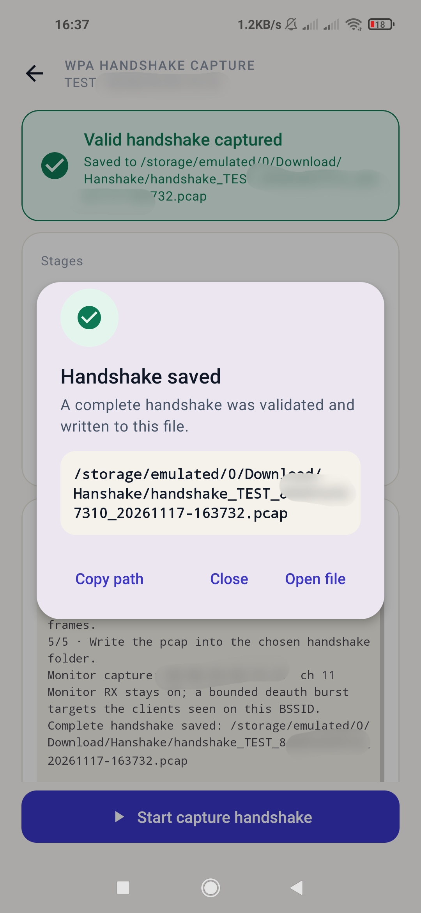

# Pixie Dust & capture handshake without Root !

<p align="center">
  
</p>

<p align="center">
  <strong>Android Wi-Fi Security Auditing &amp; Handshake Capture — No Root Required</strong>
</p>

<p align="center">
  <a href="https://github.com/mohadexter/Pixie-Dust-capture-handshake-for-android-without-root/releases/tag/v1.0.8">
    
  </a>
  
  
  
  
</p>

<p align="center">
  <a href="ARTICLE.md">📄 Technical Article</a> •
  <a href="README-BUILD.md">🔧 Build Instructions</a>
</p>

 <p align="center">
  <a href="https://t.me/PixieDustapp">
    
  </a>
</p>

---

> 📖 **Read the full write-up:** [Pixie Dust: Auditing WPS and WPA Security from an Android Phone, Without Root](ARTICLE.md) — architecture, the libusb-on-Android work, the interface, the safety rules, and the honest limits of the project.


# Download APK 👇
> https://github.com/mohadexter/Pixie-Dust-capture-handshake-for-android-without-root/releases/tag/v1.0.8


## Table of contents

- [Purpose and ethics](#purpose-and-ethics)
- [Short description](#short-description)
- [Features](#features)
- [Technical architecture](#technical-architecture)
- [Build and verification status](#build-and-verification-status)
- [Safety and privacy](#safety-and-privacy)
- [Deep dive: how it works](#deep-dive-how-it-works)
- [Supported hardware](#supported-hardware)
- [The interface](#the-interface)
- [Honest limits](#honest-limits)
- [FAQ](#faq)
- [Support the project](#support-the-project)
- [License](#license)

---

## Purpose and ethics

> ⚠️ **Pixie Dust is a cybersecurity tool**, built to help a network owner — or a tester with written authorization — evaluate the security of a **WPS** deployment and of the **WPA 4-way handshake**, and to find weaknesses before an attacker does.

| | |
|---|---|
| ✅ | Use it **only** on networks you own, or have **explicit written permission** to test |
| ✅ | A consent dialog appears before the first frame is ever transmitted |
| ✅ | No account, no telemetry — the only network call is the optional update check |
| 🔒 | Recovered PINs / passwords never leave the device |
| ⚖️ | Misuse against networks you do not own is illegal in most jurisdictions |

Questions or support: **[t.me/PixieDustapp](https://t.me/PixieDustapp)**

---

## Short description

**Pixie Dust** audits the security of **WPS** (Wi-Fi Protected Setup) on wireless networks over a **USB OTG** port, directly from an Android phone.

Written in **Java + XML** with an embedded **Python** engine on top of **libusb**, the app audits a **PIN** and extracts the **PSK** — no root, no `wpa_supplicant`, one attempt only.

## Features

| Capability | Details |
|---|---|
| 🎯 **Pixie Dust WPS audit** | One user-confirmed PIN attempt per run; outcome depends on the router/chipset |
| 🤝 **WPA 4-way handshake capture** | Validated by the bundled handshake validator before a pcap is ever saved |
| 🟢 **Known-router highlight** | Offline database of 800+ WPS-weak routers (Ralink / Realtek / Broadcom) flagged in the scan list |
| 📶 **Live client table** | Tracks client MAC addresses and signal strength in real time during scan/capture |
| 📡 **Signal-sorted network list** | Strongest first, with manufacturer and (when known) router model, cached on-device |
| 📁 **Handshake storage** | Saved to `Download/Handshake` (not `Android/data`), configurable in Settings |
| 📊 **Results & private history** | Split **Handshake** / **PixieDust** tabs, stored locally only |
| 🔄 **Optional in-app updates** | GitHub changelog check, SHA-256 + signature verified download, install only on tap |
| 🌍 **English & French** | Light theme only |

No third-party product name appears in the interface; required license/NOTICE files still ship with the source and app.

## Technical architecture

| Layer | Stack |
|---|---|
| UI | Java + XML, English + French |
| Engine | Python 3.11 (Chaquopy) + libusb 1.0.30 |
| ABIs | `arm64-v8a`, `armeabi-v7a` *(no x86, no emulator)* |
| Signing | Release, v2 — cert SHA-256 `18fab90662b96344e4548c36bcc5eebbb7c714582af2b120b746cdbfcfabb17c` |
| Updates | HTTPS request to `docs/update.json` on launch (silent offline) → `DownloadManager` + `apksigner` verification |

## Build and verification status

This source tree builds release **1.0.9** (`versionCode 10`).

- ✅ Verify the produced APK with `apksigner` before installing
- ✅ Check package/version with `aapt2 dump badging`
- 📘 Full steps: [README-BUILD.md](README-BUILD.md)

> **Note:** Physical testing with an Android phone and a supported USB OTG Wi-Fi adapter is still required — no real-device test is claimed here.

## Safety and privacy

- WPS validation makes **one attempt only** — no automatic retries, online PIN guessing, OneShot, PBC/WEP, root, or `wpa_supplicant`.
- Optional deauthentication during capture is **bounded and targeted**, never a flood. Use only on authorized networks.
- Recovered PINs/passwords live in app-private, on-device history only; clearing history removes them. The update check is the only network traffic — history is never transmitted.
- No real-device functionality is claimed until tested on compatible hardware.

---

## Deep dive: how it works

### Why this project exists

Most Wi-Fi security tooling lives on a laptop — a Linux box, a patched monitor-mode driver, a compatible USB adapter, and tools like `aircrack-ng`, `reaver`, or `hashcat`. It works, but it's heavy: a second machine, a specific OS, and drivers that break on every kernel update.

Phones are the opposite — always on hand, always charged, and capable (via USB On-The-Go) of hosting a USB Wi-Fi adapter. What was missing was the software layer to make that usable on **unrooted** Android. Pixie Dust fills that gap: one Java/Python Android app, no root, no `wpa_supplicant`, and captured data that never leaves the phone except for the optional update manifest.

### What WPS is, and why it breaks

WPS lets a user join a network with an 8-digit PIN instead of a passphrase. The protocol proves each half of the PIN separately — which slows an online brute force but also means **each half can be attacked independently**.

The real weakness is the **random number generator** inside the router. The WPS exchange relies on two secret nonces (`E-S1`, `E-S2`) generated by the access point; if that generator is predictable, an attacker who captures the exchange can reconstruct the nonces offline and derive the PIN without touching the router again.

Research from Hack.lu 2014 (Dominique Bongard — *"Cracking WPS pins in a few seconds"* / Pixie Dust) identified these implementation families:

| PRNG / implementation | Typical chipset | What goes wrong |
|---|---|---|
| 32-bit LFSR, polynomial `0x80000057` | Ralink / MediaTek | State recoverable directly from the nonces |
| `rand_r()` linear congruential generator | Realtek (RTL819x) | 32-bit state, no external entropy |
| `generic_random()` → `rand()` | Broadcom / eCos, Nucleus, Symbian | Bytes taken from `rand()`; Broadcom acknowledged the weakness |
| `E-S1 = E-S2 = 0` | Incomplete firmware | Secret nonces are never generated at all |

Atheros devices using `/dev/random` are generally **not** affected. Vendors re-skin reference code, so the same model number can ship with different chipsets, and a firmware revision can change the PRNG — the app treats its model list as a **hint**, never a guarantee.

The offline engine is the public **pixiewps** tool (`RT`, `RTL819x`, `ECOS_SIMPLE`/`ECOS_SIMPLEST`/`ECOS_KNUTH` modes), exposed in the app as *deep* search modes for when the first pass fails.

### Android version support

| Property | Value |
|---|---|
| `minSdk` | 24 — Android 7.0 (Nougat) |
| `targetSdk` / `compileSdk` | 36 — Android 16 |
| ABIs | `arm64-v8a`, `armeabi-v7a` |
| Languages | English, French |
| Theme | Light only |
| Internet permission | Only for the optional update check |

Runs on any Android 7.0–16 phone with USB OTG support (high-power adapters may need a powered hub).

### Screenshots (real device)

Captured on a real Android phone running Pixie Dust 1.0.8.

| Scan screen | Network detail sheet | Capture screen | Success frame |
|---|---|---|---|
|  |  |  |  |

- **Scan screen** — app icon in the header, network count, adapter status, Telegram support button, empty state.
- **Network detail sheet** — two equal action cards: *Capture WPA handshake* (green) and *PixieDust attack* (violet).
- **Capture screen** — five-stage stepper, live operation log, single Start/Stop button.
- **Success frame** — small overlay with the file path in heavier monospace.

### What the app actually does

#### 1 · WPS PIN audit (the "Pixie Dust attack")

Exactly **one** attempt per run:

1. **Open the adapter**, tune to the target channel; UI shows the stepper and live log.
2. **Capture M1, M2, M3** — the WPS messages carrying the nonces. If M1 never arrives, the app reports *"the router did not start a new WPS session"*, never a wrong PIN.
3. **Offline PIN search** — nonces are reconstructed and a candidate PIN derived. *Deep* mode tries additional PRNG families.
4. **Validate once** via a single M4–M7 exchange. Acceptance triggers a passphrase request, returning the PSK.
5. **Report honestly** — rejected, locked out, or not vulnerable; the app says which, then stops.

No retry loop — the app deliberately avoids consuming the router's lockout budget.

#### 2 · WPA 4-way handshake capture

The app tunes to the target network and listens for a client to authenticate, recording the four-way handshake:

```
PMK  = PBKDF2(PSK, SSID, 4096, 256)
PTK  = PRF-512(PMK, "Pairwise key expansion", min(AA,SA) || max(AA,SA) ||
               min(ANonce,SNonce) || max(ANonce,SNonce))
KCK  = first 128 bits of PTK
MIC  = HMAC-SHA1(KCK, EAPOL frame with the MIC field zeroed)
```

Capturing **M1** (AP) and **M2** (client) of the same session gives an offline cracker everything needed: MACs, both nonces, the EAPOL payload, and the MIC. A pcap is saved **only** when the bundled validator finds a crackable pair.

If no client reconnects on its own, a **bounded, targeted** deauthentication burst nudges already-observed clients to reconnect — a small number of frames, never a flood.

### The architecture

Deliberately conservative dependencies: plain Android Views (no Compose), Java/XML UI, Python engine running in-process.

```
┌────────────────────────────────────────────────────────┐
│  Java UI  (Activities, ViewBinding, Material 3)         │
│  Scan · Details · Handshake · Attack · Result · …        │
└───────────────────────┬────────────────────────────────┘
                         │  Repo: one observable state
                         │  object, one listener, main thread
┌───────────────────────▼────────────────────────────────┐
│  Bridge.java  →  pixie_android.bridge (Python)           │
│  JSON contract, one engine thread ("pixie-engine")       │
└───────────────────────┬────────────────────────────────┘
                         │
┌───────────────────────▼────────────────────────────────┐
│  Python 3.11 (Chaquopy)                                  │
│    pixie/          capture logic, PIN search, validation │
│    wifit3/         chipset drivers, firmware, monitor     │
│    pixie_android/  bridge, libusb_fd, callbacks           │
└───────────────────────┬────────────────────────────────┘
                         │  libusb 1.0.30
┌───────────────────────▼────────────────────────────────┐
│  USB OTG  →  RTL8812AU / MT7921AU / AR9271 / …           │
└────────────────────────────────────────────────────────┘
```

**One thread owns the radio.** Every operation — scan, capture, WPS attempt — is serialized through a single `pixie-engine` thread, avoiding races between components that would otherwise touch the hardware at once. The UI never blocks on the engine: it reads one observable state object (`Repo`) and redraws (adapter status, network list, client table, capture step, log, result) — one listener, main thread, no engine-to-UI callbacks.

**The Java ↔ Python contract.** `Bridge.java` owns the engine thread and exchanges JSON with `pixie_android.bridge`: commands are request/response (open, scan, capture, attack, close); events (log lines, networks found, clients changed, step changed) flow back. The JSON contract lets both layers be debugged independently.

**libusb on Android, without root.** Android's USB device nodes aren't readable by ordinary apps — but an app can get a **file descriptor** once the user grants permission via the OTG dialog. The bridge hands libusb that descriptor instead of a device path; `libusb_fd.py` handles the handover and platform quirks (e.g. `libusb_get_configuration` failing with `Operation not permitted` on some chipset/phone combinations). Native libraries are extracted at install time (`useLegacyPackaging = true`) rather than read from inside the APK zip — one reason the APK is large.

**Chipset drivers.** Each supported chipset has its own module under `wifit3/chips/`, mirroring the vendor's Linux bring-up sequence (probe → RF init → channel tune → monitor entry → RX decode → TX injection). A driver only counts as working when it behaves like the reference kernel driver — not merely when it compiles. Notable quirks: **RTL8187** (hard-MAC, 2.4 GHz only, stamps its own 802.11 sequence number); **AR9271 / RT5370 / RTL8812AU** (each with its own RF-init/channel-tune path and supported channels).

**Radio-switch (rfkill) handling.** On RTL8187 adapters the rfkill GPIO is a *polling* signal; a single cold-probe read can misreport OFF on dongles with no physical switch. The driver samples the pin and cross-checks both known masks (`0x2`, `0x4`) before declaring the radio off, while still respecting a genuine switch — and surfaces raw pin values for diagnosis.

## Supported hardware

The **Bands** column tells you whether an adapter reaches 5/6 GHz or is 2.4 GHz only.

| Group | Chipset | Adapter / variant | Bands |
|---|---|---|---|
| Ralink | RT5370 | — | 2.4 GHz only |
| Ralink | RT5372 | — | 2.4 / 5 GHz |
| Ralink | RT5572 | MIMO | 2.4 / 5 GHz |
| Ralink | RT3070 | high power | 2.4 GHz only |
| Ralink | RT2570 | legacy | 2.4 GHz only |
| MediaTek | MT7601U | (Ralink id) | 2.4 GHz only |
| MediaTek | MT7610U | AC600 | 2.4 / 5 GHz |
| MediaTek | MT7612U | AC1200 | 2.4 / 5 GHz |
| MediaTek | MT7921AU | Wi-Fi 6 | 2.4 / 5 GHz |
| MediaTek | MT7925U | Wi-Fi 7 | 2.4 / 5 / 6 GHz |
| Atheros | AR9271 | AWUS036NHA | 2.4 GHz only |
| Realtek | RTL8187 / RTL8188EUS / RTL8192FU | — | 2.4 GHz only |
| Realtek | RTL8812AU | AWUS036ACH | 2.4 / 5 GHz |
| Realtek | RTL8814AU | AC1900 | 2.4 / 5 GHz |
| Realtek | RTL8821AU | AC600 | 2.4 / 5 GHz |
| Realtek | RTL8822BU | AC1200 | 2.4 / 5 GHz |
| Realtek | RTL8922AU | Wi-Fi 7 | 2.4 / 5 / 6 GHz |
| Realtek | RTL8811CU / RTL8822CU | — | 2.4 / 5 GHz |
| TP-Link | RTL8192EU | TL-WN823N v2/v3 | 2.4 GHz only |
| TP-Link | RTL8188EUS | TL-WN722N v2/v3 | 2.4 GHz only |
| TP-Link | Archer T2U Plus | — | 2.4 / 5 GHz |

Only ARM is shipped — `arm64-v8a` and `armeabi-v7a`.

## The interface

- **Scan network** — nearby APs, strongest signal first, with manufacturer and router model.
- Tapping a network opens a sheet with BSSID, channel, encryption, WPS version, client count, and two equal cards: **Capture WPA handshake** / **PixieDust attack**.
- **Capture screen** — five-stage stepper, plain-language explanation per stage, one Start/Stop button.
- **Success/failure** — file path with Open/Copy on success, warning icon on failure.
- **Settings** — handshake storage, updates, scanning, run defaults, language, adapter driver override.
- **History** — **Handshake** / **PixieDust** tabs with live counts; Clear removes only the visible tab.
- English & French, light theme only. Telegram support button in the scan header and in About.

### The five-stage capture pipeline

| Stage | Title | What happens |
|---|---|---|
| 1 | Open the adapter | Open USB adapter, tune to target channel |
| 2 | Monitor RX | Raw monitor receive on that channel |
| 3 | Bounded deauth | Small number of deauth frames to observed clients |
| 4 | Extract EAPOL | Pull and pair EAPOL M1–M4 from captured frames |
| 5 | Save pcap | Write to the chosen handshake folder |

Bounded to a fixed window (`CAPTURE_SECONDS = 120`); stopping closes the adapter immediately.

### File output

- Saved only after the bundled validator confirms a crackable pair.
- Path: `Download/<handshake folder>/<name>.pcap`.
- Linktype `105` (IEEE 802.11) — convert with `hcxpcapngtool`, then `hashcat -m 22000`.
- A file without a complete M1/M2 pair is never presented as a valid capture.

### Error taxonomy

- `no_m1` → *"the router did not start a new WPS session"*, never "wrong PIN".
- WPS lockout is reported as lockout, not a rejected PIN.
- Adapter failures carry raw diagnostics (USB step, rfkill pins, suggested chipset) in a collapsed technical row, plus a localized headline.
- Missing adapter / wrong USB interface / missing firmware are distinct messages.

### Results & history

Recovered values (PIN + password) appear together in one success frame — short vibration, heavier monospace line, single copy action. History keeps handshakes and PixieDust results in separate tabs, stored only in app-private storage.

### Optional update channel

1. On launch, with connectivity, the app fetches `docs/update.json` from GitHub (silent if offline).
2. A newer version triggers a low-priority notification + dialog: **What's new / Later / Download**.
3. **Download** fetches the APK via `DownloadManager`, then verifies SHA-256 + signing cert — a mismatch deletes the file and blocks install.
4. A "ready to install" notification re-verifies and hands off to the system installer.
5. **Later** hides that release until a newer one appears; **What's new** shows pre-update, post-install (offline, from the bundled changelog), and from **About → Release notes**.

The manifest is read only from the project's own GitHub page; the app only installs APKs signed with the same certificate. Every screen works fully offline.

## Honest limits

- A model in the list is a **hint**, not a promise — chipset/firmware revisions vary, and the app never claims vulnerability before the attempt.
- **No lockout bypass** — one attempt, then it stops and reports.
- **2.4 GHz only** on most cheap adapters — 5/6 GHz needs the adapters listed above; unsupported channels are refused, not faked.
- **No root, no `wpa_supplicant`** — everything goes through the USB adapter and bundled driver stack.
- **No real-device test is claimed in this README** — build it, test it on your own phone/adapter/network.

## FAQ

<details>
<summary><strong>Is this legal?</strong></summary>
Auditing your own network, or one you have written permission to test, is the intended use. Attacking a network you don't own is illegal in most jurisdictions.
</details>

<details>
<summary><strong>Why is the APK so large?</strong></summary>
It bundles Python 3.11 (Chaquopy), libusb, the engine, and native libraries extracted at install time.
</details>

<details>
<summary><strong>Does it need internet?</strong></summary>
No — scan, capture and PIN search are fully offline. Only the optional update check touches the network.
</details>

<details>
<summary><strong>Does it send my passwords anywhere?</strong></summary>
No. PINs and PSKs stay in the app's private history, on-device.
</details>

<details>
<summary><strong>Can I build it myself?</strong></summary>
Yes — see <a href="README-BUILD.md">README-BUILD.md</a>. Verify the output with <code>apksigner</code>.
</details>

<details>
<summary><strong>Where do I get support?</strong></summary>
<a href="https://t.me/PixieDustapp">t.me/PixieDustapp</a>. To support development, see <a href="#support-the-project">Support the project</a>.
</details>

## The code

Full source, build instructions, release notes, and the signed APK:

**https://github.com/mohadexter/Pixie-Dust-capture-handshake-for-android-without-root**

GPL-2.0 — Java/XML for the interface, Python for the engine, libusb for the radio, no root anywhere in the stack.

## Support the project

Pixie Dust is free and independent. If it's useful to you, any amount helps — copy an address from your wallet app:

| Coin | Address |
|---|---|
|  **Bitcoin (BTC)** | `bc1qkcxl9wssq0ulfkapshupu6s4p9m9spyypgyudw` |
|  **Ethereum (ETH)** | `0x785D5A5a29FC25D7460095f8c09CEC4C6c10c8e0` |
|  **Litecoin (LTC)** | `ltc1qpsn499zgzu9sqap67w8l4vumjlda3mk7gnrnfc` |
|  **Solana (SOL)** | `8xnMikxK2SADx4ZAo46WRZ6cMZ2gdLjhegNi1PBuf1oe` |
|  **Tron (TRX)** | `TXUYnmCwXAXV7HRntyKzkkrZSDRaBVTFzK` |

Addresses are shown for information only — Pixie Dust never asks for payment to unlock a feature. Questions: [t.me/PixieDustapp](https://t.me/PixieDustapp)

## License

**GPL-2.0** — see [LICENSE](LICENSE) and [NOTICE](NOTICE).
