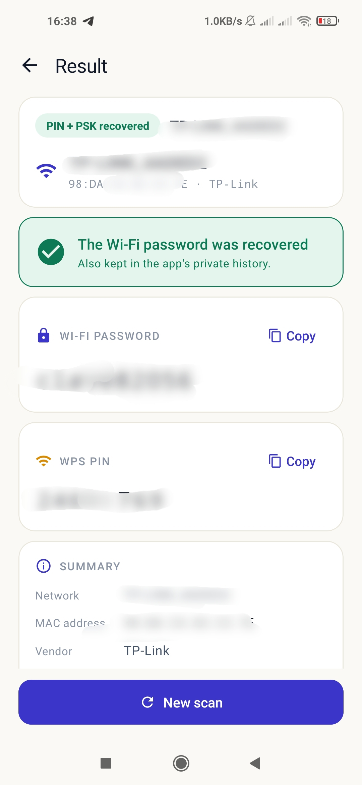

Pixie Dust – WPS & WPA Handshake Capture for Android

  

  <strong>Android Wi-Fi Security Auditing & Handshake Capture — No Root Required</strong>

  
  
  
  
  

  <a href="https://t.me/PixieDustapp">Telegram Community</a> •
  <a href="ARTICLE.md">Technical Article</a> •
  <a href="README-BUILD.md">Build Instructions</a>

---

📌 Table of Contents

- "About the Project" (#-about-the-project)
- "Why This Project Exists" (#-why-this-project-exists)
- "Screenshots" (#-screenshots)
- "Features" (#-features)
- "Android Compatibility" (#-android-compatibility)
- "Supported Hardware" (#-supported-hardware)
- "How It Works" (#-how-it-works)
- "Architecture" (#-architecture)
- "Capture Pipeline" (#-capture-pipeline)
- "Output Files" (#-output-files)
- "Update System" (#-update-system)
- "Limitations" (#-limitations)
- "FAQ" (#-faq)
- "Build from Source" (#-build-from-source)
- "Community & Support" (#-community--support)
- "License" (#-license)

---

📖 About the Project

Pixie Dust is an Android application designed for Wi-Fi security auditing and wireless handshake capture using an external USB Wi-Fi adapter.

The application provides a mobile interface for authorized WPS security auditing and WPA handshake capture without requiring root access on the Android device.

It combines Java, Python, Chaquopy, and libusb to provide a unified interface for supported USB wireless hardware.

The project is intended for educational purposes, security research, and authorized network auditing.

🎯 Why This Project Exists

Traditional wireless auditing tools often require:

- A rooted Android device.
- A Linux environment.
- Complex terminal commands.
- Manual configuration.
- External scripts and dependencies.

Pixie Dust aims to make selected wireless auditing operations accessible through a simple Android interface.

The goal is to provide a practical mobile application while keeping the underlying architecture modular and transparent.

Background

The project brings together several components:

- Android native application development.
- USB OTG communication.
- Python-based wireless operations.
- USB device communication through libusb.
- A graphical interface for monitoring operations.

For more technical background, see "ARTICLE.md" (ARTICLE.md).

📱 Screenshots

  
  
  
  

✨ Features

🔍 Wi-Fi Network Discovery

- Discover nearby wireless networks using supported hardware.
- Display available network information.
- Organize discovered network entries.
- View relevant wireless information through the application interface.

🔐 WPS Security Auditing

- WPS auditing functionality.
- One PIN attempt per audit operation.
- Designed for authorized security testing.
- Displays operation results in the application.

📡 WPA Handshake Capture

- Capture WPA handshakes using supported external USB Wi-Fi adapters.
- Validate captured handshake files.
- Save capture results locally.
- View operation status through the interface.

👥 Network Client Information

- Display available client information when supported by the hardware and capture mode.
- Present discovered information through the application interface.

📁 Local File Management

- Save capture files in a dedicated folder.
- Access saved results without navigating through Android's private application directories.
- Maintain a local operation history.

🔄 Update System

- Optional update checks through GitHub.
- SHA-256 integrity verification.
- Signature verification.
- Update information displayed inside the application.

🎨 Application Interface

- Simple Android interface.
- Light theme.
- English and French language support.
- Designed to make operations accessible without requiring terminal interaction.

📲 Android Compatibility

Component| Requirement
Minimum Android| Android 7.0 (API 24)
Target SDK| 36
Compile SDK| 36
Programming language| Java
Python runtime| Python 3.11
Root access| Not required
USB connection| USB OTG
Supported ABIs| arm64-v8a, armeabi-v7a

Important: Compatibility depends on the Android device, USB OTG support, adapter chipset, driver support, and available permissions.

🔌 Supported Hardware

The application uses external USB Wi-Fi hardware.

Actual compatibility depends on:

- The wireless chipset.
- USB adapter firmware.
- Android USB host support.
- Driver availability.
- Power requirements of the adapter.
- Compatibility with the implemented capture operations.

Not every USB Wi-Fi adapter is guaranteed to work.

A compatible OTG adapter and sufficient power may be required.

Hardware compatibility should be verified on the actual device before relying on any specific adapter.

⚙️ How It Works

Pixie Dust combines Android components with native and Python-based functionality.

At a high level:

1. Android manages the application interface and permissions.
2. USB OTG provides access to compatible external hardware.
3. libusb handles USB device communication.
4. Python components perform the relevant operations.
5. Java manages the application workflow and displays results.
6. Captured files are validated and stored locally.

The application is designed to keep the Android interface separate from the underlying hardware operations.

🏗️ Architecture

The application uses multiple layers:

1. Android Application Layer

Responsible for:

- User interface.
- Application lifecycle.
- USB permission handling.
- User interaction.
- Local file management.
- Operation history.
- Update interface.

2. Java Layer

Java coordinates the main application workflow.

It handles communication between the Android interface and the Python components.

3. Python Layer

Python 3.11 is integrated using Chaquopy.

It provides the Python runtime used by the application's wireless operation components.

4. USB Communication Layer

libusb 1.0.30 is used for USB device communication.

The external wireless adapter must be compatible with the implemented USB communication and driver requirements.

5. Storage Layer

The application stores relevant output files and local operation history.

The capture output directory is:

"Download/Handshake"

One Thread Owns the Radio

Wireless operations should be coordinated to avoid conflicting access to the same wireless hardware.

The radio operation workflow is designed around controlled access rather than allowing unrelated operations to compete for the same device.

Java ↔ Python Contract

Java and Python communicate through the application's integration layer.

This separation helps keep:

- Android UI responsibilities in Java.
- Python operation logic in Python.
- Hardware communication in the USB layer.

libusb Integration

The application uses libusb 1.0.30 for USB communication.

USB permissions and device compatibility remain dependent on Android and the connected hardware.

Chipset Drivers

Wireless adapter support depends on chipset compatibility and the availability of the required driver functionality.

A USB connection alone does not guarantee that an adapter supports the application's operations.

rfkill

Wireless radio control can depend on the operating environment and hardware support.

Android devices and USB adapters may expose different capabilities, so behavior should be evaluated on the target hardware.

📡 Capture Pipeline

The capture workflow can be understood in five stages:

1. Device Detection — Identify the connected USB wireless adapter.
2. Initialization — Prepare the required communication components.
3. Operation — Execute the selected authorized auditing or capture operation.
4. Validation — Check the resulting capture file.
5. Storage — Save the resulting file and update the local history.

Output File

Capture files are stored in:

"Download/Handshake"

This location is intended to make the generated files easier to find using a regular Android file manager.

Error Handling

The application may encounter errors related to:

- USB permissions.
- Unsupported hardware.
- Missing driver support.
- Device initialization.
- Adapter power requirements.
- Capture operation failures.
- Invalid or incomplete output files.

The result depends on the connected hardware and the Android environment.

📋 Results & History

The application provides a local history of operations.

This helps users review previous operations and access the corresponding output files.

The availability of information depends on the operation performed and the connected hardware.

🔄 Update Channel

Pixie Dust includes an optional update mechanism based on GitHub.

The update workflow includes:

- Checking for available releases.
- Displaying update information.
- SHA-256 integrity verification.
- Signature verification.

Updates are optional and should be obtained from the official project release channel.

Official repository:

https://github.com/mohadexter/Pixie-Dust-capture-handshake-for-android-without-root

⚠️ Honest Limitations

Please keep the following limitations in mind:

- Not all Android devices support USB OTG.
- Not all USB Wi-Fi adapters are compatible.
- Some adapters may require additional power.
- Android USB permissions can vary by device.
- Driver availability affects hardware functionality.
- Actual operation results depend on the wireless environment.
- No successful real-device compatibility claim should be assumed without testing the specific device and adapter.

This project is under development, and compatibility should be tested in the intended environment.

❓ FAQ

Does Pixie Dust require root access?

No. The application is designed to operate without requiring root access on the Android device.

Does it work without an external Wi-Fi adapter?

The intended wireless hardware operations require a compatible external USB Wi-Fi adapter.

Does every USB Wi-Fi adapter work?

No. Compatibility depends on the chipset, driver support, USB communication, and Android device.

Which Android versions are supported?

The minimum supported Android version is Android 7.0 (API 24).

Where are capture files saved?

The intended output directory is:

"Download/Handshake"

Does the application support WPS auditing?

Yes. The project includes WPS auditing functionality with one PIN attempt per audit operation.

Can I use it on networks I do not own?

Only use the application on networks you own or have explicit permission to test.

Where can I find build instructions?

See "README-BUILD.md" (README-BUILD.md).

🛠️ Build from Source

To build the project from source, you need the Android development environment and the required project dependencies.

The project uses:

- Java.
- Android SDK.
- Gradle.
- Python 3.11.
- Chaquopy.
- libusb 1.0.30.

For detailed build instructions, dependencies, and configuration, see:

"README-BUILD.md" (README-BUILD.md)

🤝 Contributing

Contributions, bug reports, compatibility feedback, and suggestions are welcome.

If you want to contribute:

1. Fork the repository.
2. Create a feature branch.
3. Make your changes.
4. Test your changes.
5. Submit a Pull Request.

Please include relevant device and adapter information when reporting hardware compatibility issues.

💬 Community & Support

  

  <strong>Join the Telegram Community</strong> 
  <a href="https://t.me/PixieDustapp">https://t.me/PixieDustapp</a>

For issues, suggestions, and bug reports, use the GitHub repository:

"GitHub Issues" (https://github.com/mohadexter/Pixie-Dust-capture-handshake-for-android-without-root/issues)

⚖️ Legal & Ethical Use

This project is intended for:

- Educational purposes.
- Authorized wireless security auditing.
- Security research.
- Testing networks that you own or have explicit written permission to assess.

Do not use this application to access, monitor, or test networks without authorization.

The user is responsible for complying with applicable laws and regulations.

📜 License

Pixie Dust is distributed under the GNU General Public License v2.0 (GPL-2.0).

See the "LICENSE" (LICENSE) file for the complete license terms.

---

  <strong>Pixie Dust</strong> 
  Android Wireless Security Auditing  
  <a href="https://github.com/mohadexter/Pixie-Dust-capture-handshake-for-android-without-root">GitHub Repository</a> •
  <a href="https://t.me/PixieDustapp">Telegram</a>

  Made for learning, research, and authorized security testing.

