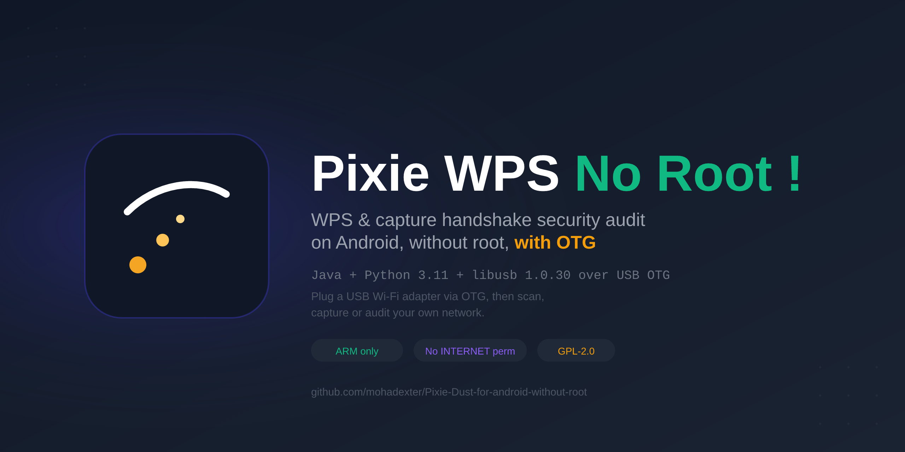

# Pixie Dust — Project README



# Telegram Channel (docs/icons/telegram.png)
## https://t.me/PixieDustapp


> **Read the full article:** [Pixie Dust: Auditing WPS and WPA Security from an Android Phone, Without Root](ARTICLE.md) — a technical write-up covering the architecture, the libusb-on-Android work, the interface, the safety rules and the honest limits of the project.

## Purpose and ethics

**Pixie Dust is a cybersecurity tool.** Its purpose is to help a network owner (or a tester who has written authorization) evaluate the security of a **WPS** deployment and of the **WPA 4-way handshake** on a Wi-Fi network, and to discover weaknesses before an attacker does.

- Use it **only on networks you own** or for which you have **explicit written permission** to test.
- The app asks for confirmation before every operation and shows a consent dialog before the first frame is transmitted.
- It has no account and no telemetry. The only network use is the optional update check (one manifest request and, if you accept, the APK). Recovered PINs/passwords never leave the device.
- Misuse of this tool against networks you do not own is illegal in most jurisdictions.
- Need help or want to follow releases? Join **[t.me/PixieDustapp](https://t.me/PixieDustapp)**.

## Short description

**Pixie Dust** is a security app for Android that audits the security of **WPS** (Wi-Fi Protected Setup) on wireless networks over a **USB OTG** port.

The app is written in **Java + XML** with an internal **Python** engine, and runs on the embedded **libusb** engine. Its goal: audit a **PIN**, then extract the **PSK**, without root, without `wpa_supplicant`, and with a single attempt only.

## Features

- **Pixie Dust WPS audit** with one user-confirmed PIN attempt per run; the supported model and router behaviour determine whether a PIN or PSK is returned.
- **WPA 4-way handshake capture** is validated by the bundled handshake validator before a pcap is saved; invalid or incomplete captures are reported and never presented as valid files.
- **Known-router highlight** in the scan list: routers reported as WPS-weak (offline database, 800+ entries, including Ralink/Realtek/Broadcom chipset strings) show a green name and a **Pixie** pill. Generic labels such as *Wireless AP* are not treated as supported models.
- **Live client table** during scans and capture, showing observed client MAC addresses and signal strength. It follows a device when it appears and removes it when it disconnects.
- **Network list sorted by signal strength** (strongest first) and showing the manufacturer and, when known, router model. Manufacturer/model values are cached on-device, so a later scan that misses the WPS information element still shows the same router.
- **Handshake storage in `Download/Handshake`** (not `Android/data`), with a Settings option to pick another system folder or a custom folder name.
- **Results and private history** show verified captures and credentials recovered on-device. History is split into **Handshake** and **PixieDust** tabs. It is stored locally and is not sent over the network.
- **Optional in-app updates**: the app checks GitHub on launch when online, offers a changelog, downloads with SHA-256 + signature verification, and installs only when you tap. Nothing is forced.
- **English and French** interface; light theme only.
- No third-party product name is displayed in the interface; the required license and NOTICE files still ship with the source and the app.

## Technical architecture

- UI: Java + XML, two locales: English, French.
- Engine: Python 3.11 (Chaquopy) + libusb 1.0.30.
- ABIs: `arm64-v8a` + `armeabi-v7a` (no x86, no emulator).
- Signing: release, v2, certificate SHA-256 `18fab90662b96344e4548c36bcc5eebbb7c714582af2b120b746cdbfcfabb17c`.
- Update channel: one HTTPS request to `docs/update.json` on launch (non-blocking, silent when offline), then `DownloadManager` + `apksigner` verification of the APK before the system installer.

## Build and verification status

This source tree builds release **1.0.9** (versionCode **10**). Verify the produced APK with `apksigner` before installing it, and check the package/version with `aapt2 dump badging`. See [README-BUILD.md](README-BUILD.md).

Physical testing with an Android phone and a supported USB OTG Wi-Fi adapter is still required. No real-device test is claimed here.

## Safety and privacy

- WPS validation makes one attempt only; no automatic retries, online PIN guessing, OneShot, PBC/WEP, root, or `wpa_supplicant`.
- Optional deauthentication during a capture is bounded and targeted; it is not a flood. Use only on networks you own or are authorized to test.
- Recovered PINs/passwords are stored in the app-private on-device history. Clear history in the app to remove those records. The only network use is the optional update check; this history is never transmitted.
- No real-device functionality is claimed until tested with compatible hardware.

---

# Pixie Dust: Auditing WPS and WPA Security from an Android Phone, Without Root

*A technical walkthrough of a native Android app that runs a complete USB Wi-Fi security audit on a phone, with no root, no `wpa_supplicant`, and no account.*

---

## Why this project exists

Most Wi-Fi security tooling lives on a laptop. You install a Linux distribution, patch a driver to support monitor mode and packet injection, plug in a compatible USB adapter, and start `aircrack-ng`, `reaver`, or `hashcat`. It works, but it is heavy. It needs a second machine, a specific operating system, and a stack of driver patches that break with every kernel update.

Phones are the opposite: always with you, always charged, and — thanks to USB On-The-Go — perfectly capable of hosting a USB Wi-Fi adapter. What has been missing is the software layer that makes that hardware usable on unrooted Android.

**Pixie Dust** is an attempt to fill that gap. It is a single Android application, written in Java with an embedded Python engine, that brings a WPS audit and a WPA handshake capture to an ordinary phone. It does not require root, it does not touch `wpa_supplicant`, and captured data never leaves the phone: the only network request is the optional update manifest.

The project is open source under GPL-2.0:

**https://github.com/mohadexter/Pixie-Dust-capture-handshake-for-android-without-root**

---

## Background: what WPS is, and why it breaks

WPS (Wi-Fi Protected Setup) was designed so a user could join a network by typing an eight-digit PIN instead of a long passphrase. The protocol splits the PIN in half and proves knowledge of each half in separate messages; that split is what makes an online brute force slower, but it also means the **first half and the second half can be attacked separately**.

The deeper problem is not the protocol, it is the **random number generator** inside the router. The WPS exchange depends on two secret nonces, `E-S1` and `E-S2`, generated by the access point. If those nonces come from a predictable generator, an attacker who captures the exchange can reconstruct them offline and derive the PIN without touching the router again.

Research presented at Hack.lu 2014 (Dominique Bongard, "Cracking WPS pins in a few seconds" / Pixie Dust) identified several implementation families:

| PRNG / implementation | Typical chipset | What goes wrong |
|---|---|---|
| 32-bit LFSR, polynomial `0x80000057` | Ralink / MediaTek | State can be recovered directly from the nonces |
| `rand_r()` linear congruential generator | Realtek (RTL819x) | 32-bit state, no external entropy |
| `generic_random()` → `rand()` | Broadcom / eCos, Nucleus, Symbian | Bytes are taken from `rand()`; Broadcom acknowledged the weakness |
| `E-S1 = E-S2 = 0` | Firmware with an incomplete implementation | The secret nonces are not generated at all |

Atheros devices that use `/dev/random` are generally **not** affected. Because vendors re-skin the same reference code, the same model number can ship with different chipsets — and a different firmware revision can change the PRNG. That is why the app treats the model list as a **hint**, never a guarantee.

The offline engine behind this work is the public **pixiewps** tool, which supports several attack modes (`RT` for Ralink/MediaTek, `RTL819x` for Realtek, and the `ECOS_SIMPLE` / `ECOS_SIMPLEST` / `ECOS_KNUTH` variants for Broadcom/eCos-style generators). The app exposes these as its *deep* search modes, so a user can try more models when the first pass fails.

---

## Android version support

| Property | Value |
|---|---|
| `minSdk` | **24 — Android 7.0 (Nougat)** |
| `targetSdk` / `compileSdk` | **36 — Android 16** |
| ABIs | `arm64-v8a`, `armeabi-v7a` (ARM only, no x86, no emulator) |
| Languages | English, French |
| Theme | Light only |
| Internet permission | Only for the optional update check (manifest + APK); never for captured data |

The app runs on any Android phone from Android 7.0 up to Android 16, as long as the phone supports USB OTG and can power the adapter (high-power adapters may need a powered hub).

---

## Screenshots (real device)

The following screenshots were taken on a real Android phone running Pixie Dust 1.0.8.

| Scan screen | Network detail sheet | Capture screen | Success frame |
|---|---|---|---|
|  |  |  |  |

- **Scan screen:** app icon in the header, "Scan network" title, adapter status, network count, the Telegram support button and the empty state.
- **Network detail sheet:** the two action cards side by side — "Capture WPA handshake" (green) and "PixieDust attack" (violet).
- **Capture screen:** the five-stage stepper, the live operation log, and the single Start/Stop button.
- **Success frame:** the small frame over the screen, with the file path in heavier monospace text.

---

## What the app actually does

Pixie Dust has two jobs, and it keeps them strictly separate.

### 1. WPS PIN audit (the "Pixie Dust attack")

The app performs **exactly one** attempt per run:

1. **Open the adapter and tune to the target channel.** The driver brings up monitor receive; the UI shows the stepper and the live log.
2. **Capture M1, M2 and M3.** These three WPS messages are the ones that carry the nonces. If the router never sends M1, the app reports *"the router did not start a new WPS session"* — it is never presented as a wrong PIN.
3. **Offline PIN search.** The engine reconstructs the router's nonces from the captured values and derives a candidate PIN. The *deep* mode tries additional PRNG families when the first pass fails.
4. **Validate once.** The candidate is sent in a single **M4–M7** exchange. If the router accepts it, the same session asks for the passphrase and the PSK comes back.
5. **Report honestly.** Rejected, locked out, or not vulnerable: the app says which one happened and stops.

There is no retry loop. The WPS spec counts failed attempts, and the app deliberately does not try to consume the router's lockout budget.

### 2. WPA 4-way handshake capture

The second job is the classic one. The app tunes to the target network, listens to the channel, and waits for a client to authenticate so it can record the four-way handshake.

The four-way handshake derives the session key from the pairwise master key (PMK) and two nonces (`ANonce` from the access point, `SNonce` from the client):

```
PMK  = PBKDF2(PSK, SSID, 4096, 256)
PTK  = PRF-512(PMK, "Pairwise key expansion", min(AA,SA) || max(AA,SA) ||
               min(ANonce,SNonce) || max(ANonce,SNonce))
KCK  = first 128 bits of PTK
MIC  = HMAC-SHA1(KCK, EAPOL frame with the MIC field zeroed)
```

Capturing **M1** (from the AP) and **M2** (from the client) of the same session gives an offline cracker everything needed to test the PSK: the MAC addresses, the two nonces, the EAPOL payload and the MIC. The app therefore saves a pcap only when the bundled validator finds such a **crackable pair**.

If no client reconnects on its own, a **bounded and targeted** deauthentication burst nudges the clients already observed on that BSSID into reconnecting. It is a small number of frames, not a flood.

---

## The architecture

The application is deliberately conservative about its dependencies. It uses plain Android Views, not Compose. The UI layer is Java and XML. The engine layer is Python, running in-process.

```
┌────────────────────────────────────────────────────────┐
│  Java UI  (Activities, ViewBinding, Material 3)        │
│  Scan · Details · Handshake · Attack · Result · …      │
└───────────────────────┬────────────────────────────────┘
                        │  Repo: one observable state
                        │  object, one listener, main thread
┌───────────────────────▼────────────────────────────────┐
│  Bridge.java  →  pixie_android.bridge (Python)         │
│  JSON contract, one engine thread ("pixie-engine")     │
└───────────────────────┬────────────────────────────────┘
                        │
┌───────────────────────▼────────────────────────────────┐
│  Python 3.11 (Chaquopy)                                │
│    pixie/        capture logic, PIN search, validation │
│    wifit3/       chipset drivers, firmware, monitor    │
│    pixie_android/  bridge, libusb_fd, callbacks        │
└───────────────────────┬────────────────────────────────┘
                        │  libusb 1.0.30
┌───────────────────────▼────────────────────────────────┐
│  USB OTG  →  RTL8812AU / MT7921AU / AR9271 / …         │
└────────────────────────────────────────────────────────┘
```

### One thread owns the radio

The single most important design decision is that **exactly one thread ever talks to the USB device**. The engine runs on a dedicated `pixie-engine` thread, and every operation — scan, capture, WPS attempt — is serialised through it. This avoids the races that appear when two components (scan loop and capture loop) touch the same hardware at once.

The UI never blocks on the engine. It reads a single observable state object (`Repo`) and redraws: adapter status, network list, client table, capture step, log lines, result. One listener, main thread, no callbacks from the engine to the UI.

### The Java ↔ Python contract

`Bridge.java` owns the engine thread and exchanges JSON messages with `pixie_android.bridge`. Commands are request/response (open adapter, start scan, capture, attack, close), and events (log lines, networks found, clients changed, step changed) flow back. Keeping the contract in JSON means the two layers can be debugged independently: the Java side logs the exact payload it sends, and the Python side can be exercised on a desktop.

### Getting libusb to work on Android without root

On a desktop, libusb opens a device by path. On Android, the USB device node under `/dev/bus/usb/` is not readable by an ordinary app. An app *can* get a **file descriptor** from the system, after the user grants permission through the standard OTG dialog.

The bridge therefore hands libusb an already-open descriptor instead of a device path, and lets libusb wrap it. The bundled `libusb_fd.py` module handles that handover and the platform quirks, including `libusb_get_configuration` failing with `Operation not permitted` on some chipset/phone combinations.

Native libraries must exist as **real files on disk**, not inside the APK's zip. The build is configured with `useLegacyPackaging = true` so libusb is extracted at install time. This is also why the APK is large: it carries Python 3.11, libusb and the engine.

### The chipset drivers

Each supported chipset has its own module under `wifit3/chips/`. A driver mirrors the vendor's Linux bring-up sequence — probe (EEPROM MAC, TX power, asic revision), RF initialisation, channel tune, monitor entry, RX descriptor decode, TX injection. The acceptance gate reproduces the on-the-wire sequence, so a driver is only considered working when it behaves like the reference kernel driver, not when it merely compiles.

The driver stack also carries the per-chipset quirks, for example:

- **RTL8187** — hard-MAC, 2.4 GHz only, no active monitor for a forged MAC; the driver stamps its own 802.11 sequence number because the L-path has no hardware sequence assignment.
- **AR9271 / RT5370 / RTL8812AU** — each has its own RF-init and channel-tune path, and its own set of supported channels.

### Radio-switch (rfkill) handling

On RTL8187 adapters the rfkill GPIO is a *polling* signal. A single cold-probe read can report OFF on dongles with no physical switch, so the driver samples the pin and cross-checks both known masks (`0x2` and `0x4`) before declaring the radio off. A genuine switch that stays off is still respected, and the failure message shows the raw pin values so a real hardware problem can be diagnosed.

### Supported hardware

The **Bands** column is the single most useful piece of information for a buyer: it tells you whether the adapter can reach 5 GHz and 6 GHz networks or is limited to 2.4 GHz.

| Group | Chipset | Adapter / variant | Bands |
|---|---|---|---|
| Ralink | RT5370 | — | **2.4 GHz only** |
| Ralink | RT5372 | — | 2.4 / 5 GHz |
| Ralink | RT5572 | MIMO | 2.4 / 5 GHz |
| Ralink | RT3070 | high power | **2.4 GHz only** |
| Ralink | RT2570 | legacy | **2.4 GHz only** |
| MediaTek | MT7601U | (Ralink id) | **2.4 GHz only** |
| MediaTek | MT7610U | AC600 | 2.4 / 5 GHz |
| MediaTek | MT7612U | AC1200 | 2.4 / 5 GHz |
| MediaTek | MT7921AU | Wi-Fi 6 | 2.4 / 5 GHz |
| MediaTek | MT7925U | Wi-Fi 7 | **2.4 / 5 / 6 GHz** |
| Atheros | AR9271 | AWUS036NHA | **2.4 GHz only** |
| Realtek | RTL8187 / RTL8188EUS / RTL8192FU | — | **2.4 GHz only** |
| Realtek | RTL8812AU | AWUS036ACH | 2.4 / 5 GHz |
| Realtek | RTL8814AU | AC1900 | 2.4 / 5 GHz |
| Realtek | RTL8821AU | AC600 | 2.4 / 5 GHz |
| Realtek | RTL8822BU | AC1200 | 2.4 / 5 GHz |
| Realtek | RTL8922AU | Wi-Fi 7 | **2.4 / 5 / 6 GHz** |
| Realtek | RTL8811CU / RTL8822CU | — | 2.4 / 5 GHz |
| TP-Link | RTL8192EU | TL-WN823N v2/v3 | **2.4 GHz only** |
| TP-Link | RTL8188EUS | TL-WN722N v2/v3 | **2.4 GHz only** |
| TP-Link | Archer T2U Plus | — | 2.4 / 5 GHz |

Only ARM is shipped — `arm64-v8a` and `armeabi-v7a`.

---

## The interface

The app is designed to be usable by someone who has never run a Wi-Fi audit before, without hiding what it is doing.

- **Scan network** lists nearby access points, strongest signal first, with manufacturer and router model.
- Tapping a network opens a sheet with technical facts — BSSID, channel, encryption, WPS version, client count — and exactly two equal cards: **Capture WPA handshake** and **PixieDust attack**.
- The **capture screen** walks through five stages with a live stepper, a plain-language stage explanation, and one button toggling *Start capture handshake* / *Stop capture*.
- On success a small frame shows the file path (Open file / Copy path); on failure a warning icon is shown.
- **Settings** puts handshake storage first, then updates, scanning, run defaults, language and the adapter driver override.
- **History** is split into **Handshake** and **PixieDust** tabs with live counts; **Clear** only removes the visible tab.
- Available in **English and French** only, light theme only.
- A Telegram support button sits in the scan header and in **About**.

---

## The five-stage capture pipeline

| Stage | Title (EN) | What the code does |
|---|---|---|
| 1 | Open the adapter | Open the USB adapter and tune to the target channel. |
| 2 | Monitor RX | Raw monitor receive: every frame on that channel is read. |
| 3 | Bounded deauth | Send a small number of deauth frames to clients seen on this BSSID. |
| 4 | Extract EAPOL | Pull EAPOL M1–M4 out of the captured frames and pair them. |
| 5 | Save pcap | Write the pcap to the chosen handshake folder. |

A capture is bounded to a fixed window (`CAPTURE_SECONDS = 120`). The UI stepper, the live log and the single Start/Stop button keep the user in control the whole time: the adapter is closed immediately when the attempt is stopped.

---

## The file that gets written

- The pcap is written only after the bundled validator confirms a crackable pair.
- The published path is `Download/<handshake folder>/<name>.pcap`.
- For offline analysis, the pcap uses linktype `105` (IEEE 802.11), so it can be converted with `hcxpcapngtool` and then fed to `hashcat -m 22000`.
- A file that does not contain a complete M1/M2 pair is never presented as a valid capture.

---

## The error taxonomy

- `no_m1` is never shown as "wrong PIN". It is surfaced as *"the router did not start a new WPS session"*.
- A **WPS lockout** is reported as lockout, not as a rejected PIN.
- Adapter bring-up failures carry the raw diagnostic (USB step, rfkill pins, suggested chipset) in a collapsed technical-details row, and a localised headline in English/French.
- A missing adapter, a wrong USB interface and a missing firmware are separate messages, so the user can act on the real cause instead of guessing.

---

## The result and history

- Recovered values (WPS PIN and Wi-Fi password) are shown together on the result screen, in one success frame with a short vibration, a heavier monospace line, and a single copy action.
- History keeps handshakes and PixieDust results in two separate tabs, with counts, and stores them only in the app's private storage.

---

## Optional update channel

Pixie Dust can keep itself current without a store. The design is deliberately opt-in:

1. On launch, if a connection is available, the app fetches `docs/update.json` from GitHub. The request is non-blocking and silent when offline.
2. If a newer version exists, a low-priority notification and an in-app dialog appear: **What's new**, **Later**, **Download**.
3. **Download** fetches the APK with `DownloadManager` into app storage, then verifies the published **SHA-256** and the signing certificate. A mismatch deletes the file and refuses the install.
4. A "ready to install" notification opens a small screen that re-verifies and hands the file to the Android system installer.
5. **Later** hides that release until a newer one appears. **What's new** is shown before the update, on the first launch after it (offline, from the changelog bundled in the APK), and from **About → Release notes**.

The update manifest is only ever read from the project's own GitHub page, and the installed app will only install an APK signed with the same certificate. The channel can also be ignored completely: every screen still works offline.

---

## Honest limits

- **A model in the list is a hint, not a promise.** Chipset and firmware revisions differ; the same model number can behave differently. The app never claims a network is vulnerable before the attempt.
- **No lockout bypass.** The app makes one attempt and stops. If the router reports lockout, it says so.
- **2.4 GHz only on most cheap adapters.** 5 GHz / 6 GHz requires the adapters listed above; the app refuses channels it cannot use instead of pretending.
- **No root, no `wpa_supplicant`.** Everything goes through the USB adapter and the bundled driver stack.
- **No real-device test is claimed in this README.** If you build it, test it on your own phone, your own adapter and your own network.

---

## FAQ

**Is this legal?** Auditing your own network, or one you have written permission to test, is the intended use. Attacking a network you do not own is illegal in most jurisdictions.

**Why is the APK so large?** It bundles Python 3.11 (Chaquopy), libusb and the engine, plus native libraries extracted at install time.

**Does it need internet?** No. The scan, capture and PIN search are fully offline. Only the optional update check touches the network.

**Does it send my passwords anywhere?** No. PINs and PSKs stay in the app's private history on the device.

**Can I build it myself?** Yes — see [README-BUILD.md](README-BUILD.md). Verify the output with `apksigner`.

**Where do I get support?** [t.me/PixieDustapp](https://t.me/PixieDustapp). To support development, see [Support the project](#support-the-project).

---

## The code

The full source, build instructions, release notes and the signed APK are here:

**https://github.com/mohadexter/Pixie-Dust-capture-handshake-for-android-without-root**

GPL-2.0. Java and XML for the interface, Python for the engine, libusb for the radio, and no root anywhere in the stack.

If you build it, test it on your own hardware and your own network. That is the only testing that counts.

## Support the project

Pixie Dust is free and independent. If it is useful to you, you can support its development — any amount helps. Copy an address from your wallet app:

| Coin | Address |
|---|---|
|  **Bitcoin (BTC)** | `bc1qkcxl9wssq0ulfkapshupu6s4p9m9spyypgyudw` |
|  **Ethereum (ETH)** | `0x785D5A5a29FC25D7460095f8c09CEC4C6c10c8e0` |
|  **Litecoin (LTC)** | `ltc1qpsn499zgzu9sqap67w8l4vumjlda3mk7gnrnfc` |
|  **Solana (SOL)** | `8xnMikxK2SADx4ZAo46WRZ6cMZ2gdLjhegNi1PBuf1oe` |
|  **Tron (TRX)** | `TXUYnmCwXAXV7HRntyKzkkrZSDRaBVTFzK` |

Addresses are shown for information only; Pixie Dust never asks for a payment to unlock a feature. Questions or feedback: [t.me/PixieDustapp](https://t.me/PixieDustapp).

---

## License

**GPL-2.0** — see [LICENSE](LICENSE) and [NOTICE](NOTICE).
